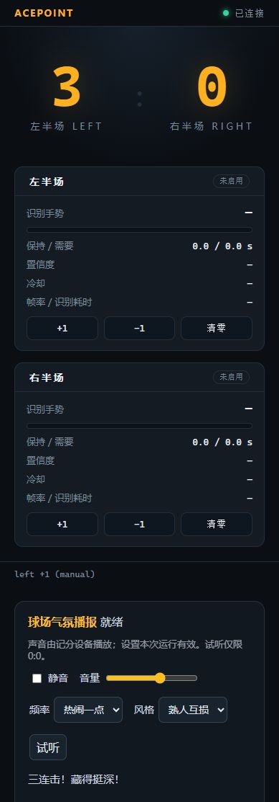

# 语音气氛播报

## 快速体验

在项目虚拟环境中执行：

```powershell
pip install -e ".[dev,audio]"
python scripts/check_audio_pack.py
acepoint --audio-check
acepoint --audio-test
```

`--audio-check` 校验75段素材、实际打开输出设备但不发声；`--audio-test` 播放三连击、终结、决胜球和获胜示例，不需要摄像头或模型。即使常规运行的 `audio.enabled=false`，显式试听命令仍可使用；静音和音量设置仍被尊重。

也可以打开真实互动演示：

```powershell
python scripts/audio_demo.py --port 8089
```

访问 <http://127.0.0.1:8089>，用左右半场的“+1／-1／清零”体验。此模式只模拟计分，不连接摄像头；会按配置输出声音。`--silent` 使用NullPlayer，仅更新播报文字，适合界面测试。

快速连点3次左方“+1”，稍等0.4秒会听到三连击。正常语音之间有6秒最小间隔；短时间连点可能被抑制，关键比分和获胜优先。点击“清零”会停止旧局声音，恢复新局。

## 正常运行

`config.toml` 和 `config.pi.toml` 已包含 `[audio]`，默认关闭。试听确认音箱和音量后，将对应文件的 `audio.enabled` 改为 `true`，照常启动：

```powershell
acepoint
acepoint -c config.pi.toml
```

主要选项：

| 设置 | 作用 |
|---|---|
| `enabled` | 启动音频工作线程，关闭时不加载pygame |
| `backend` | `pygame`实际出声，`null`只记录播报供测试 |
| `pack_root` | 音频包路径，相对配置文件目录，默认`audio` |
| `volume` | 0～1，默认0.6 |
| `muted` | 静音立即清理待播／停止当前声音，取消静音不补播 |
| `style` | `friends`熟人互损、`clean`文明鼓励 |
| `mode` | `balanced`热闹一点、`key_only`关键时刻、`effects_only`仅关键音效 |
| `device_name` | pygame音频设备名称，空字符串使用系统默认设备 |
| `allow_web_control` | 允许网页修改音频设置，独立于手动计分权限 |

网页设置只对本次进程有效；需要保留的设置写入TOML。试听按钮仅在0:0且可播放时启用，服务端限制每5秒一次。设备正在计分时停止试听。

声音只从运行AcePoint的设备播放。用手机打开网页不会在手机上再次播报。Pi默认只开LED／console，如需网页调音，将 `display.backends` 增加 `web`。

## 规则与纠错

- 三／五／七连击依据连续有效得分；破蛋、终结、追平和反超也会触发。
- 一分最多播一个片段，获胜优先。20平进入加分阶段，29平一分定胜负；21:20不能宣告获胜。
- 指定半场“-1”会移除该半场最近一条得分记录并重算统计。减分不是任意历史回合编辑，直接设置比分则建立新基线，不猜测过去连得分。
- 减分取消待播并停止当前声音；同事件、同侧、同比分在30秒内不重复播放，避免反复撤销刷音效。
- 音频在独立线程运行，队列最多一条待播。文件、声卡或依赖异常会显示状态并降级，比分继续工作。
- 自定义赛制复用原有胜负规则；20平／29平专用语音仅在标准21分制启用。

## 素材与实现

`audio/manifest.json` 管理75个片段，约9.5MB。当前中文为Windows中文语音引擎生成的可用初版，配原创合成短音效，尚未做专业电竞配音或球馆听感调音。换配音按 `audio/README.md` 替换文件，运行校验脚本。

播放前缓存音频（最大16MiB），计分路径不读音频文件。工作线程使用单声道、单Channel；关键事件80ms淡出抢占。损坏／缺少某句时运行模式尝试同事件音效回退；严格自检会报出缺失项。

实际实现使用 `ScoreBoard.apply_with_change()` 原子返回不可变前后Snapshot，用版本号去重，由AudioService持有局ID；没有另加一套全局事件总线。引擎直接设置比分必须使用 `ScoringEngine.set_score()`，以同步取消播报及重建基线。原始开发方案中的清单格式改为JSON，便于生成及替换素材。

## 已验证与实机待验收

- Windows虚拟环境：全套自动化测试、75段音频包校验、实际pygame设备初始化及四事件试听命令通过。
- 浏览器：移动端布局、真实网页加分到三连击播报文字链路已验证，截图见下图。
- 树莓派／球馆待验收：无桌面systemd音频输出、音箱接线与供电、30分钟连续运行、启用前后采样率、实际音量与续航。未把这些项目标成已通过。


